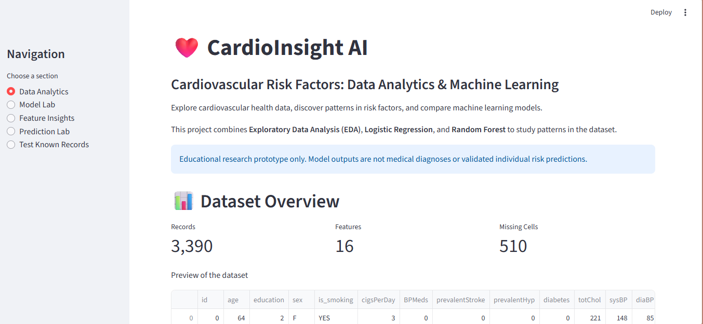
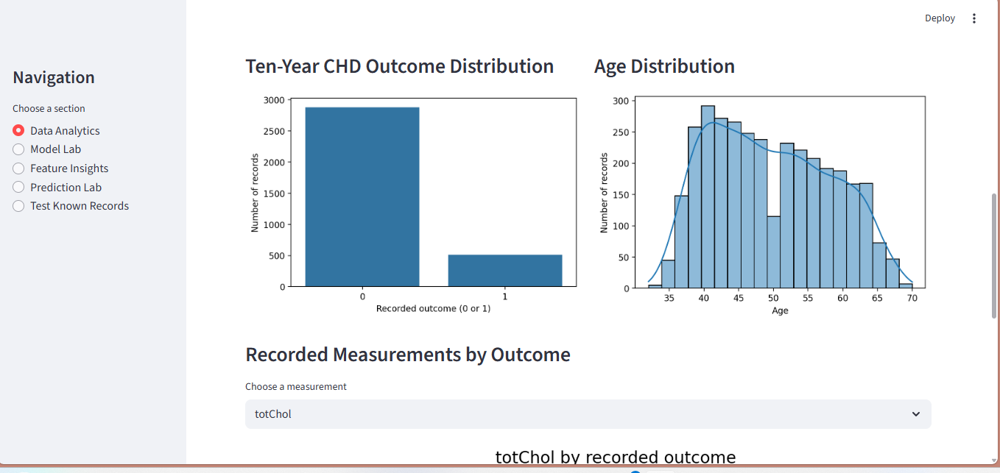
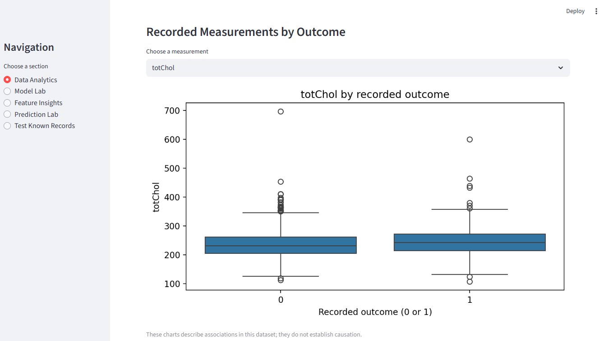
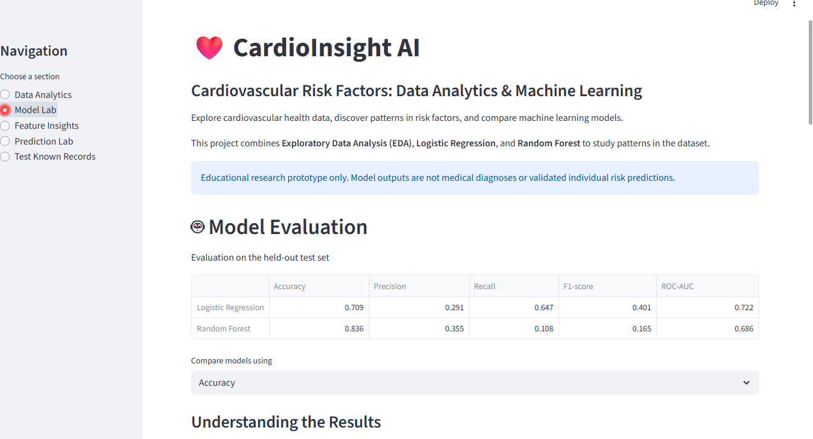
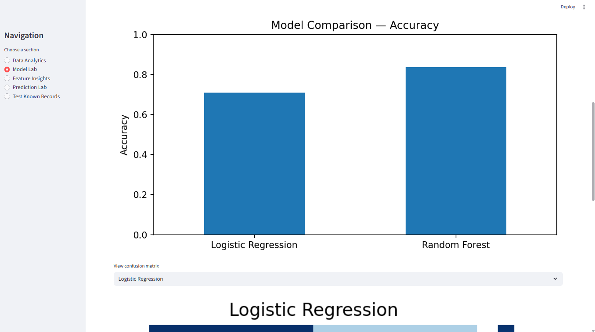
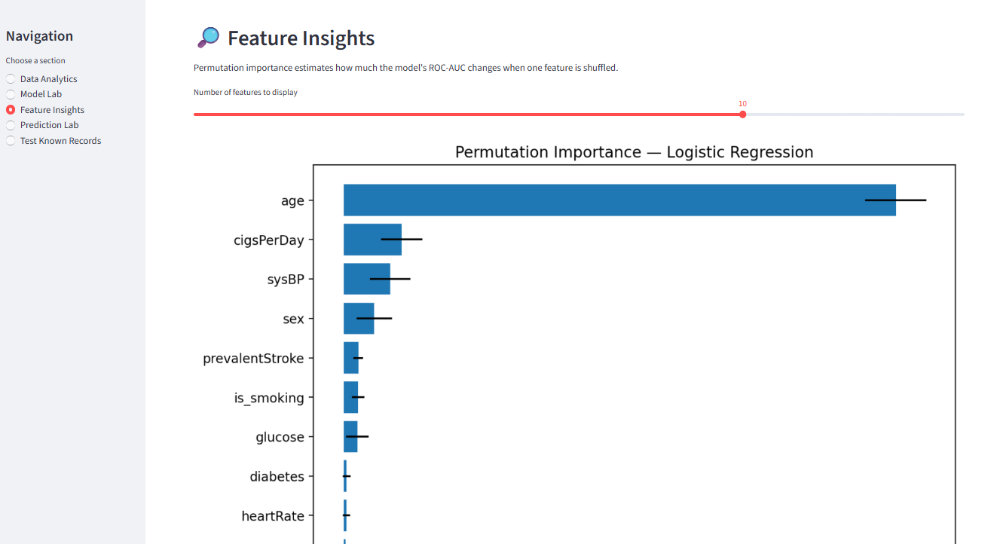
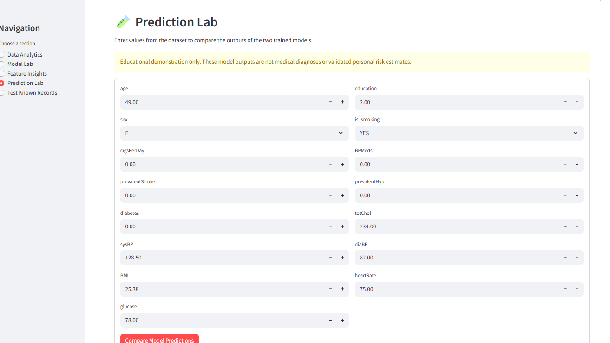
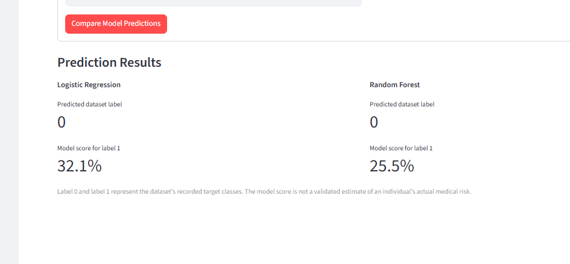
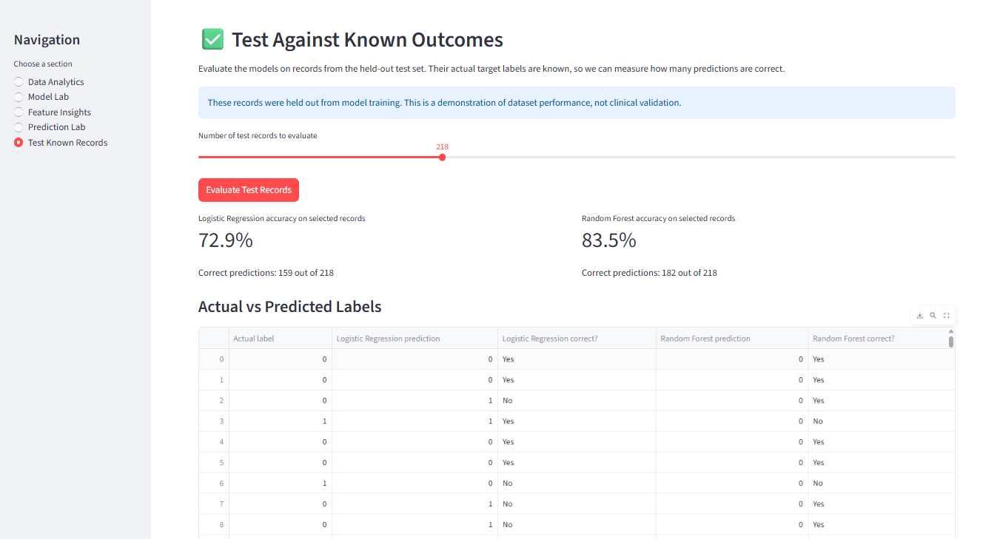

# ❤️ CardioInsight AI
### Cardiovascular Risk Factors: Data Analytics & Machine Learning

CardioInsight AI is an educational machine learning and data analytics project that explores cardiovascular risk-factor data, visualizes patterns in the dataset, and compares Logistic Regression and Random Forest classification models.

The project provides an interactive dashboard built with Streamlit to demonstrate exploratory data analysis, model evaluation, feature importance, and predictions on user-entered sample data.

> **Disclaimer:** This is a student research prototype for educational purposes only. It is not a medical diagnostic tool, does not provide clinically validated individual risk estimates, and must not be used to make healthcare decisions.

## ✨ Features

- **Dataset Overview:** Explore the dataset, record counts, missing values, and sample records.
- **Exploratory Data Analysis (EDA):** Visualize target-class distribution, age distribution, and measurements grouped by recorded outcome.
- **Model Comparison:** Evaluate Logistic Regression and Random Forest using Accuracy, Precision, Recall, F1-score, and ROC-AUC.
- **Confusion Matrix:** Compare actual and predicted classes on the held-out test set.
- **Feature Insights:** Explore permutation feature importance for the Logistic Regression model.
- **Prediction Lab:** Enter sample feature values and compare outputs from both trained models.
- **Test Known Records:** Compare predictions against known labels from selected held-out test records.

## 🛠️ Technology Stack

- Python
- Streamlit
- Pandas and NumPy
- Matplotlib and Seaborn
- Scikit-learn

## 📊 Dataset

The project uses the `P5-Cardio Vascular Risk Prediction.csv` dataset.

The dataset contains cardiovascular-related attributes such as age, smoking status, cigarette consumption, blood pressure, cholesterol, BMI, glucose, and other recorded factors.

The target column is `TenYearCHD`, representing the dataset's recorded ten-year coronary heart disease outcome.

The `id` column is excluded from model features. Missing feature values are handled using median imputation for numeric columns and most-frequent imputation for categorical columns.

**Dataset source and license:** Add the original dataset URL, creator, and license here before publishing the dataset or claiming permission to redistribute it.

## 🤖 Machine Learning Methodology

1. Load and inspect the dataset.
2. Remove duplicate records and records with a missing target.
3. Separate the input features from the target column.
4. Split the data into training and testing sets using an 80:20 split and stratification.
5. Impute missing values and scale numeric features.
6. Encode categorical features.
7. Train Logistic Regression and Random Forest classification pipelines.
8. Evaluate both models on the held-out test set.
9. Calculate permutation importance for Logistic Regression using ROC-AUC scoring.

The dashboard displays metrics computed when the models are trained. Model performance may vary with the dataset and evaluation setup.

## 📁 Project Structure

```text
CardioInsightAI/
├── app/
│   └── app.py
├── data/
│   └── P5-Cardio Vascular Risk Prediction.csv
├── README.md
└── requirements.txt
```

## ⚙️ Installation and Setup

### 1. Clone the repository

```bash
git clone https://github.com/YOUR_USERNAME/CardioInsightAI.git
cd CardioInsightAI
```

Replace `YOUR_USERNAME` with your GitHub username and update the repository name if yours differs.

### 2. Create a virtual environment

```bash
python -m venv venv
```

Activate it on Windows:

```bash
venv\Scripts\activate
```

### 3. Install dependencies

```bash
pip install -r requirements.txt
```

### 4. Add the dataset

Place the dataset CSV inside the `data/` directory using the filename shown in the project structure.

### 5. Run the application

```bash
python -m streamlit run app/app.py
```

Streamlit will provide a local URL, typically `http://localhost:8501`.

## 📈 Model Evaluation

The dashboard reports:

| Metric | Purpose |
|---|---|
| Accuracy | Overall proportion of correct predictions |
| Precision | Proportion of predicted positives that are correct |
| Recall | Proportion of actual positives identified |
| F1-score | Harmonic mean of precision and recall |
| ROC-AUC | Ranking discrimination across classification thresholds |

The dataset has an imbalanced target distribution, so accuracy should not be considered in isolation. Interpret all results in the context of the dataset and test procedure.

## 🔍 Feature Importance

Permutation importance measures how model performance changes when a feature's values are shuffled. It helps explore which features the fitted model relies on most in the evaluation data.

Feature importance does not establish causation or prove that a feature is a medical risk factor.

## 📸 Dashboard Screenshots

Explore the different modules of CardioInsight AI.

### 1. Data Analytics

Visualize the dataset and explore its key patterns.







### 2. Model Evaluation

Compare the classification models and examine their evaluation results.





### 3. Feature Insights

Explore the features and their estimated importance to the trained model.



### 4. Prediction Lab

Enter feature values and explore the model's predicted class.





### 5. Test Known Records

Compare predictions against known labels in the held-out test dataset.



> **Disclaimer:** CardioInsight AI is an educational machine-learning prototype. Its predictions are not medical diagnoses or clinically validated estimates of individual cardiovascular risk.
## ⚠️ Limitations

- This is an educational prototype, not a clinically validated model.
- Predictions and model scores should not be interpreted as personal medical risk estimates.
- Dataset bias, class imbalance, missing values, and the selected train-test split can affect results.
- The current evaluation does not establish generalization to other populations.
- Further testing, external validation, calibration analysis, and clinical review would be required before any healthcare use.

## 🚀 Future Improvements

- Add more comprehensive model validation and cross-validation.
- Evaluate probability calibration and decision thresholds.
- Improve interactive data exploration and reporting.
- Add reproducible experiment tracking.
- Explore external validation on an appropriate, independently sourced dataset.

## 👩‍💻 Author

**Anet Colin Rockey**

- GitHub: [AnetColin](https://github.com/AnetColin)
- LinkedIn: [Anet Colin Rockey](https://www.linkedin.com/in/anetrockey/)

